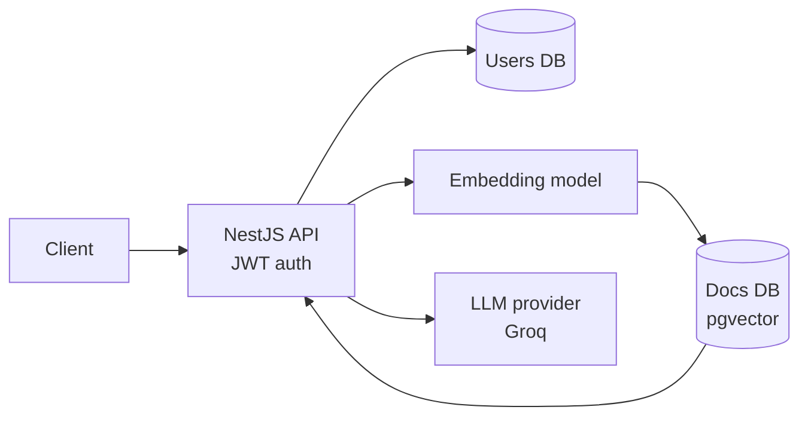

# Hi, I'm Sajib Sarker 👋

**Full-Stack & Backend Engineer · DevOps · AI Platform**

I build scalable SaaS platforms, serverless systems, and cloud infrastructure, and I'm now focused on AI platform engineering (RAG, vector search, LLM integration). Open to remote roles.

📍 Bangladesh (Remote) · 🔗 [LinkedIn](https://linkedin.com/in/sajibs1104003) · ✉️ sajibsarker1104003@gmail.com 
[Professional Github](https://github.com/ssarker-coder-ops)

---

## 🤖 AI & Platform Engineering

- **RAG services:** document ingestion, embeddings, vector similarity search, and LLM-backed answers
- **Vector databases:** PostgreSQL + pgvector
- **Embeddings:** self-hosted embedding models (1024-dim) alongside hosted LLM providers such as Groq
- **AI integration:** shipping AI-powered services behind production backend APIs
- **Secure access:** JWT authentication, separated user and document databases

### ⭐ Featured: [nest-rag-service](https://github.com/sajibsarker-1104003/nest-rag-service)

A NestJS Retrieval-Augmented Generation service with pgvector, local embeddings, and JWT auth.

**Stack:** NestJS · Prisma · PostgreSQL · pgvector · JWT · Vitest

---

## 🔧 Skills

| Area | Technologies |
|---|---|
| **Languages** | TypeScript, JavaScript, C#, C, Python, Bash |
| **Backend** | NestJS, Express, Node.js, Microsoft .NET, REST APIs, Domain-Driven Design |
| **Frontend** | React, Next.js |
| **AI / Data** | RAG, pgvector, embeddings, LLM integration |
| **ORM** | Prisma, Entity Framework, Sequelize, Mongoose, MongoDB .NET Driver |
| **Databases** | PostgreSQL, MySQL, MongoDB, Redis, DynamoDB, S3 |
| **Cloud** | AWS (Lambda, API Gateway, Fargate, ECR, VPC), Azure |
| **Infrastructure as Code** | Terraform, CloudFormation |
| **Containers** | Docker, Kubernetes |
| **CI/CD** | GitHub Actions, Jenkins |
| **Monitoring** | ELK, Datadog |
| **Testing** | Jest, Vitest |
| **Collaboration** | Jira, Confluence, Slack |

---

## 💼 What I've Built

- **Risk Management SaaS platform:** led backend and cloud automation across Enterprise, Project, Audit, Compliance, Cybersecurity, and Incident Management modules (NestJS, .NET, Prisma, PostgreSQL, DDD).
- **Serverless on AWS:** provisioned infrastructure with Terraform and built cost-efficient, secure architectures on Lambda and API Gateway.
- **Microservices:** containerized services with Docker and ran them on Kubernetes and AWS Fargate with automated deployment and scaling.
- **CI/CD:** built GitHub Actions pipelines for testing, integration, and releases.
- **Performance:** added Redis caching to cut database load and latency.
- **Cloud networking:** designed secure AWS VPC environments with planned subnets and security groups.
- **Full-stack SaaS:** shipped an event-based SaaS product with NestJS, Next.js, serverless payment endpoints, and Terraform.
- **AI and blockchain integrations:** delivered AI-powered services and blockchain-based authentication behind backend APIs.

---

## 🌱 Currently

Building and open-sourcing AI platform projects, and sharpening my full-stack and DevOps portfolio. Looking for **Backend, Full-Stack, DevOps, or AI Platform Engineer** roles.

Let's connect, I'm always happy to talk about SaaS, cloud automation, and AI systems.
